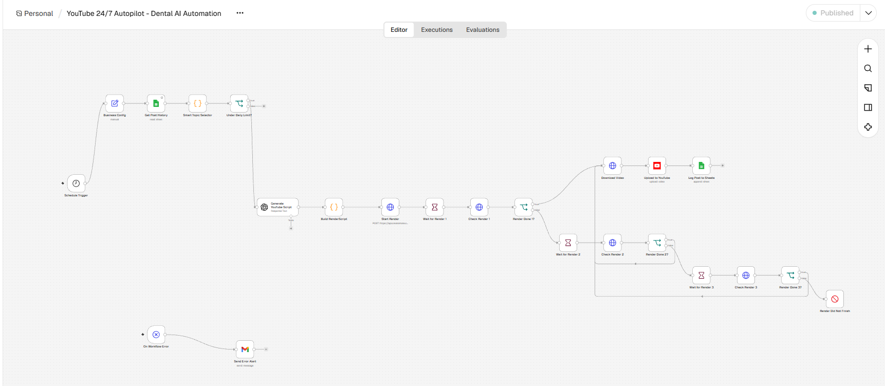
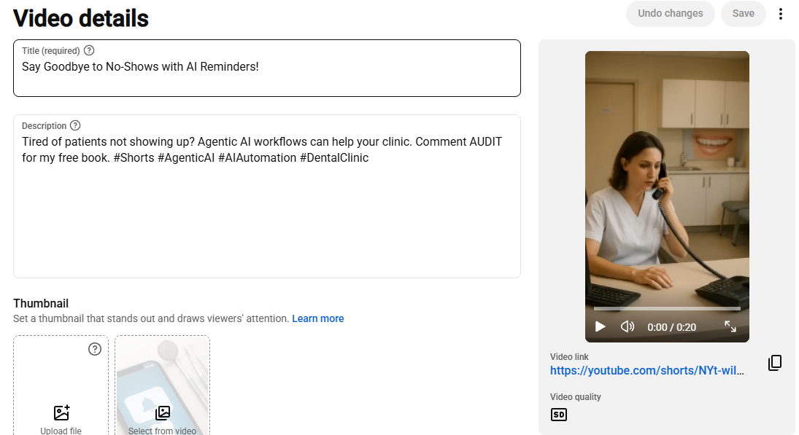
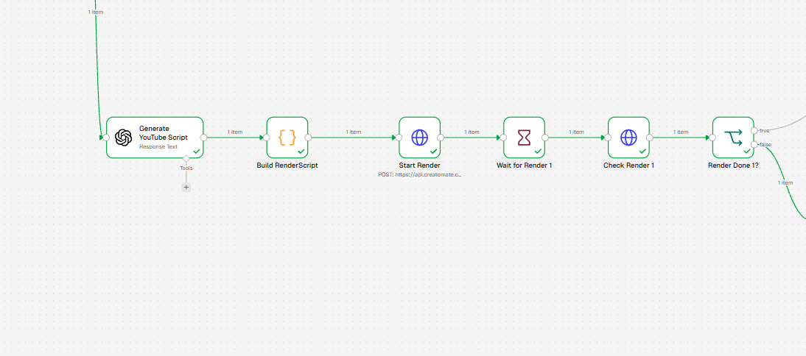
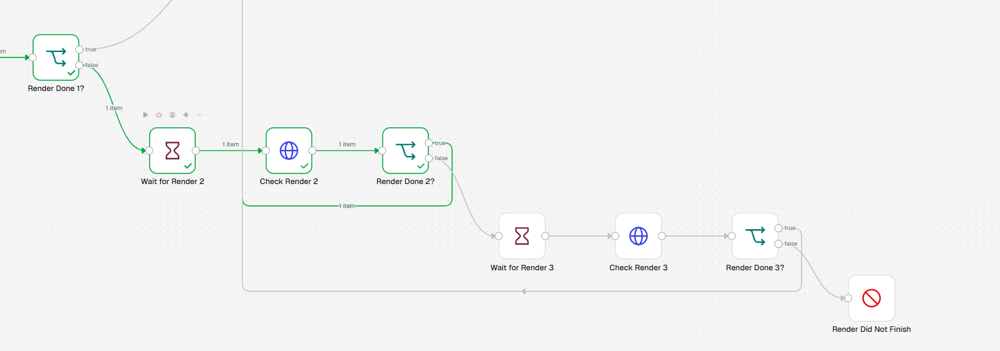
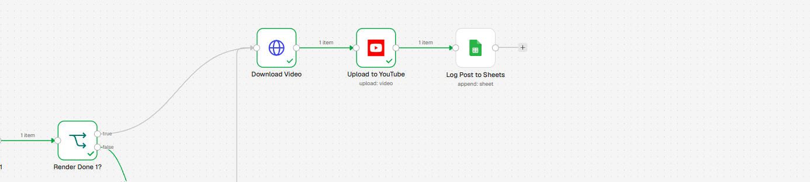

# YouTube Automation by AI Agent for Dental Clinics

An n8n workflow that automates a YouTube Shorts content pipeline for a dental clinic: topic selection, script generation, scene creation, video rendering, YouTube upload, and publishing-history logging.

> **Public-repository safety:** This repository contains a sanitized workflow export. Credential references have been removed, the workflow is inactive, and private configuration values have been replaced with setup placeholders. You must configure your own credentials and IDs before running it.

## Problem

Dental clinics may want to publish educational short-form videos consistently, but researching topics, writing scripts, creating videos, uploading them, and tracking past content can require repeated manual work.

## What the workflow does

1. **Schedule Trigger** — starts on a schedule (configured for Monday, Wednesday, and Friday at 6:30 PM in the `Asia/Kolkata` timezone).
2. **Business Config** — stores the clinic context, audience, content pillars, call-to-action keywords, daily post limit, Google Sheet ID, and alert email.
3. **Get Post History** — reads the `youtube_posts` tab in Google Sheets.
4. **Smart Topic Selector** — checks the number of posts already published that day, avoids recently used topics where possible, and selects a topic and writing angle.
5. **Under Daily Limit?** — stops the content path if the configured daily limit has been reached.
6. **Generate YouTube Script** — uses an OpenAI model to return a structured script with a title, description, tags, and five scenes.
7. **Build RenderScript** — validates the generated JSON and prepares a vertical video composition with scene images, generated voiceover, and transcript text.
8. **Start Render** — sends the video composition to Creatomate.
9. **Wait / Check Render** — checks render status with up to three wait-and-check attempts.
10. **Download Video** — downloads the completed video.
11. **Upload to YouTube** — uploads the video with its title, description, and tags.
12. **Log Post to Sheets** — records the selected topic and published video information.
13. **Error Notification** — sends an email alert if the workflow execution fails.

## Technology stack

- n8n — workflow orchestration
- OpenAI — topic/script generation and scene assets
- Creatomate API — video rendering
- Google Sheets — content history and publishing log
- YouTube API — video upload
- Gmail — error notifications
- JavaScript — topic selection, validation, and render-payload preparation

## Screenshots

### Complete workflow

### YouTube video details

### Script generation and rendering

### Render status monitoring

### Render and upload execution

## Before you run it

1. Import `workflow.json` into your n8n instance.
2. Create or select the Google Sheet and add a tab named `youtube_posts` with the columns expected by the workflow (for example: `date`, `topic`, `angle`, `postText`, `imagePrompt`, `imageUrl`, `linkedinPostId`, `status`, `timestamp`).
3. Replace `REPLACE_WITH_YOUR_GOOGLE_SHEET_ID` with your own Google Sheets document ID.
4. Replace `REPLACE_WITH_YOUR_ALERT_EMAIL` in the Business Config and error-notification node.
5. Reconnect your own Google Sheets, OpenAI, Creatomate, YouTube, and Gmail credentials in n8n.
6. Review the business configuration, content prompts, schedule, and publishing settings before activating the workflow.
7. Test the workflow with your own accounts and content first.

## Important publishing note

The exported workflow is configured to upload videos with YouTube privacy status set to **unlisted**. Change this setting to public only after reviewing and testing the workflow and its generated content.

## Skills demonstrated

- Workflow automation with n8n
- AI agent and prompt design
- OpenAI integration
- REST API integration
- JavaScript
- Automated video generation
- Google Sheets integration
- YouTube publishing automation
- Error handling and monitoring

## Disclaimer

This is a demonstration workflow. You are responsible for configuring credentials, reviewing generated content, complying with platform policies, and verifying all publishing settings before use.
